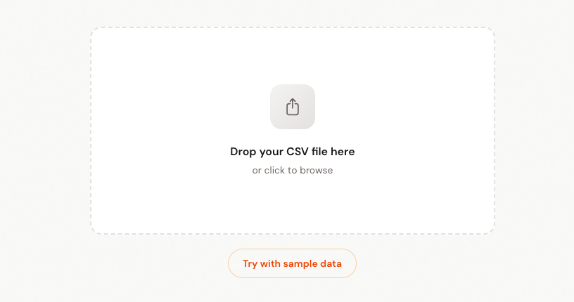

# Copilot Billing Report Viewer

Analyze GitHub Copilot AI Credit billing exports. See per-user consumption, quota tracking, model and token breakdowns, and billed costs — all processed locally in your browser.

## Live Demo

Try the Sample Data option on the upload screen to see how it works without needing to upload your own report.

**Live App:** https://gh.io/pru-view



## Features

- Per-user AI Credit consumption and monthly quota status
- Model usage distribution in a flat-color treemap (tile area proportional to AI Credits), plus token breakdowns
- Billed costs and daily included vs. additional usage in USD
- Cost center and organization breakdowns
- Consumption groups, feature adoption insights, and recommendations

Select a single billing month to compare consumption against known quotas.
Daily charts use UTC billing dates. Cost charts appear only when monetary data
is available; token views appear when token counts are reported.

## Supported CSV Format

This application supports AI Credit rows in the GitHub Copilot expanded billing export format. A request-only export is rejected; in a mixed export, transitional premium-request rows are ignored so they cannot contaminate AI Credit totals.

Get your report from the expanded billing export in Copilot spending or enterprise
usage dashboards. See the official [GitHub Copilot usage and entitlements documentation](https://docs.github.com/en/enterprise-cloud@latest/copilot/managing-copilot/monitoring-usage-and-entitlements/monitoring-your-copilot-usage-and-entitlements).

### Example
```csv
date,username,product,sku,model,quantity,unit_type,applied_cost_per_quantity,gross_amount,discount_amount,net_amount,total_monthly_quota,organization,repository,cost_center_name,aic_quantity,aic_gross_amount,input,output,cache_read,cache_write
2026-06-01,test-user-one,copilot,copilot_ai_credit,Claude Sonnet 4.5,21.36,ai-credits,0.01,0.2136,0.2136,0,3900,test-org-one,,test-cost-center-one,0,0,1420,590,175000,4200
```

**Minimum required columns:**
- `date` (YYYY-MM-DD UTC day; internally normalized to midnight UTC)
- `username`
- `model`
- `quantity`
- `unit_type` (`ai-credit` or `ai-credits`) or a recognized AI-credit `sku`

**Optional billing & organizational columns** (auto-detected when present):
- `applied_cost_per_quantity`, `gross_amount`, `discount_amount`, `net_amount`
- `total_monthly_quota`
- `product`, `sku`, `organization`, `repository`, `cost_center_name`
- `aic_quantity`, `aic_gross_amount`

Current Business and Enterprise monthly AI Credit quota values are defined in `src/constants/pricing.ts`. Commercial fields and token counts can be omitted; the viewer does not invent missing billed amounts.

### Optional token columns

The ingestion pipeline accepts `input`, `output`, `cache_read`, and `cache_write`.
It also accepts the respective compatibility aliases `total_input_tokens`,
`total_output_tokens`, `total_cache_read_tokens`, and `total_cache_creation_tokens`.

User details show a **Daily Model Usage Breakdown** table, a **Token Usage Over Time**
chart with a model selector, and a **Model Consumption Breakdown** for the selected
billing period.

Missing counts display as `—`, explicit zeros as `0`, and incomplete table totals
as `(partial)`. Missing or incomplete daily counts leave gaps in token charts
rather than false zeros. Token-only exports are supported without inventing
monetary values.

Token counts do not change AI Credits, quotas, or monetary calculations.

## Privacy
All processing is client-side. No data leaves your browser.

## Contributing

Issues and pull requests are welcome.

---

**Note**: This tool is not affiliated with GitHub. It's a community-created utility for analyzing Copilot usage reports.
