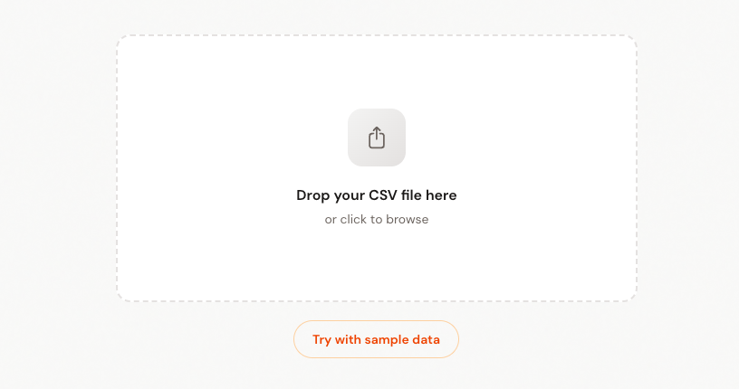
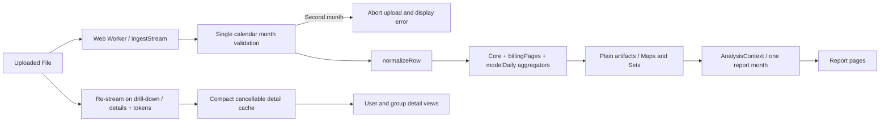

# Copilot Billing Report Viewer

Analyze GitHub Copilot AI Credit billing exports. See per-user consumption, quota tracking, model and token breakdowns, and billed costs — all processed locally in your browser.

## Live Demo

Try the Sample Data option on the upload screen to see how it works without needing to upload your own report.

**Live App:** https://gh.io/pru-view



## Features

- Per-user AI Credit consumption and monthly quota status
- Model usage distribution in a flat-color treemap (tile area proportional to AI Credits), plus token breakdowns
- Model Usage Trends includes four AI Credit ring charts for Auto and Fusion (Standard, High, Max), with prefix-trimmed model names and gross USD costs in compact legends (reported AI Credit gross amounts, or credit value at the configured rate when absent)
- Billed costs and daily included vs. additional usage in USD
- Cost center and organization breakdowns
- Consumption groups, feature adoption insights, and recommendations

Upload a report covering one calendar month to compare consumption against known quotas.
Daily charts use UTC billing dates. Cost charts appear only when monetary data
is available; token views appear when token counts are reported.
Model ring cards keep a consistent height. Legends show the top five models;
expanding reveals the rest in a scrollable list without resizing the card.
Empty buckets explain the absence of usage for the selected period.

## Supported CSV Format

This application supports AI Credit rows in the GitHub Copilot expanded billing export format. A request-only export is rejected; in a mixed export, transitional premium-request rows are ignored so they cannot contaminate AI Credit totals.

Reports must cover a **single calendar month**, identified as `YYYY-MM` from the
source date column without timezone conversion. The upload stops as soon as a
second month appears and displays an error; export each billing month separately.
Dates may be ISO dates/timestamps or US `M/D/YY` / `M/D/YYYY` dates.

Get your report from the expanded billing export in Copilot spending or enterprise
usage dashboards. See the official [GitHub Copilot usage and entitlements documentation](https://docs.github.com/en/enterprise-cloud@latest/copilot/managing-copilot/monitoring-usage-and-entitlements/monitoring-your-copilot-usage-and-entitlements).

### Example
```csv
date,username,product,sku,model,quantity,unit_type,applied_cost_per_quantity,gross_amount,discount_amount,net_amount,total_monthly_quota,organization,repository,cost_center_name,aic_quantity,aic_gross_amount,input,output,cache_read,cache_write
2026-06-01,test-user-one,copilot,copilot_ai_credit,Claude Sonnet 4.5,21.36,ai-credits,0.01,0.2136,0.2136,0,3900,test-org-one,,test-cost-center-one,0,0,1420,590,175000,4200
```

**Minimum required columns:**
- `date` (YYYY-MM-DD UTC day; internally normalized to midnight UTC)
- `username`
- `model`
- `quantity`
- `unit_type` (`ai-credit` or `ai-credits`) or a recognized AI-credit `sku`

**Optional billing & organizational columns** (auto-detected when present):
- `applied_cost_per_quantity`, `gross_amount`, `discount_amount`, `net_amount`
- `total_monthly_quota`
- `product`, `sku`, `organization`, `repository`, `cost_center_name`
- `aic_quantity`, `aic_gross_amount`

Current Business and Enterprise monthly AI Credit quota values are defined in `src/constants/pricing.ts`. Commercial fields and token counts can be omitted; the viewer does not invent missing billed amounts.

### Optional token columns

The ingestion pipeline accepts `input`, `output`, `cache_read`, and `cache_write`.
It also accepts the respective compatibility aliases `total_input_tokens`,
`total_output_tokens`, `total_cache_read_tokens`, and `total_cache_creation_tokens`.

User details show a **Daily Model Usage Breakdown** table with cache success rates,
calculated as cache-read tokens divided by input plus cache-read and cache-write
tokens. Partial rates use only rows reporting all three counts. The page also includes
a **Token Usage Over Time** chart with a model selector and a **Model Consumption
Breakdown** for the selected billing period.

Missing counts display as `—`, and explicit zeros remain distinguishable in token
views. Missing or incomplete daily counts leave gaps in token charts rather than
false zeros. Token-only exports are supported without inventing monetary values.

Token counts do not change AI Credits, quotas, or monetary calculations.

### Single-month analytics

Report ingestion retains no source-row arrays. `ingestStream` validates source
dates before CSV chunks flow through `normalizeRow` and the registered
aggregators. The worker returns plain artifacts via structured clone.
`AnalysisContext` exposes these finalized artifacts directly and derives its
view models with `useArtifactAnalysis`, never by reconstructing rows.
Memory use grows with aggregate cardinality (users, models,
days, and groups), rather than the number of CSV rows.

The six core ingestion aggregators (`usage`, `quota`, `dailyBuckets`, `featureUsage`,
`billing`, and `tokens`) finalize directly to structured-clone-safe totals, Maps,
and Sets, not rows or accumulator instances. There are no month partitions,
merge selectors, or month-selection state. Billing uses the streamed commercial
totals, never recomputed amounts from retained rows.

The `billingPages` aggregator supplies organization and cost-center product
totals, distinct named users, and Cloud Agent/Code Review
billing tables. Map insertion order preserves source-order ties without
provenance metadata. User costs and consumption insights use the core billing,
usage, and quota artifacts.

The `modelDaily` page aggregator supplies product costs, Auto Mode savings, daily
commercial model totals, Auto/Fusion distributions and distinct-user sets without
retaining source rows. Model credits reuse core usage/billing artifacts. Daily
views use `buildBillingMonthDates(reportMonth)` to fill the report's complete UTC
calendar month, including inactive boundary days. Cumulative totals carry through
inactive days; missing token counts stay `null`. Report `dateRange` remains the
observed data window. Reported zero amounts and per-row cost fallbacks remain
distinct from absent billing fields.



## Privacy
All processing is client-side. No data leaves your browser.

CSV parsing and aggregators run in a Web Worker in 1 MiB chunks. The uploaded
`File` remains in memory-only app state until reset or reload. User, organization,
and cost-center drill-downs re-stream it with
`streamFile(file, aggregatorIds, rowFilter?, options?)` from
`src/utils/ingestion/streamFile.ts`. Filters combine `user`, `organization`,
and `costCenter` with AND semantics. Missing organizations/cost centers match
`Unassigned`. Single-month validation runs before these predicates.
Results preserve aggregator output Maps/Sets through structured clone.
Drill-downs keep only compact detail/token aggregates, cached by uploaded File
and filter. Loading displays scanned-row progress; closing a
detail view or changing its filters cancels its worker via `options.signal`.
Environments without Web Worker support use the same streaming pipeline on the
main thread; worker startup/runtime failures are surfaced rather than retried there.

## Contributing

Issues and pull requests are welcome.

---

**Note**: This tool is not affiliated with GitHub. It's a community-created utility for analyzing Copilot usage reports.
